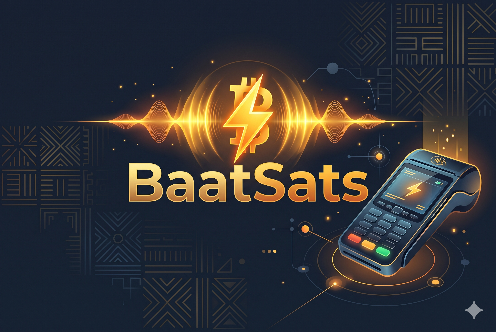
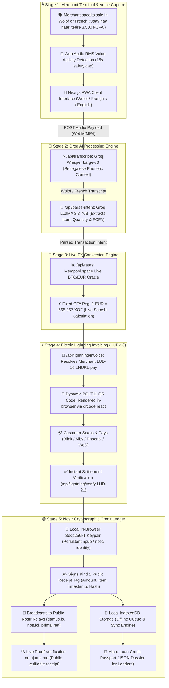

# ⚡ BaatSats — Voice-First Wolof & French AI Merchant POS over Bitcoin Lightning & Nostr

<p align="center">
  
</p>

<p align="center">
  <a href="https://btrust.tech/"></a>
  <a href="https://lightning.network/"></a>
  <a href="https://nostr.com/"></a>
  <a href="https://groq.com/"></a>
  <a href="https://nextjs.org/"></a>
</p>

> **Built for the Dakar Bitcoin Hack by Btrust (Nov 2026)**  
> Empowering informal street merchants in Dakar (*Marché Sandaga, Marché HLM, Tilène*) to accept instant, low-fee Bitcoin Lightning payments by speaking naturally in **Wolof** or **French**, while automatically building a verifiable **Nostr Cryptographic Credit Ledger** to qualify for micro-finance inventory loans.

---

## 📑 Table of Contents

- [1. The Local Problem & Impact](#1-the-local-problem--impact)
- [2. End-to-End Application Flow](#2-end-to-end-application-flow)
- [3. System Architecture](#3-system-architecture)
- [4. Core Innovations & Key Features](#4-core-innovations--key-features)
- [5. Security by Design & Threat Model](#5-security-by-design--threat-model)
- [6. Quick Start Guide](#6-quick-start-guide)
  - [Prerequisites](#prerequisites)
  - [Option A: Local Development](#option-a-local-development)
  - [Option B: One-Command Docker Setup](#option-b-one-command-docker-setup)
- [7. Testable Happy Path (For Hackathon Judges)](#7-testable-happy-path-for-hackathon-judges)
- [8. Sandaga Market Seed Data](#8-sandaga-market-seed-data)
- [9. Constraints, Metrics & Roadmap](#9-constraints-metrics--roadmap)
- [10. Acknowledgements](#10-acknowledgements)

---

## 1. The Local Problem & Impact

Dakar's vibrant informal economy powers daily life across Senegal, yet traditional fintech solutions fail street merchants:

* **🗣️ Language & Literacy Barrier:** Over 70% of Dakar's informal market vendors transact primarily in **Wolof** rather than written French. Traditional mobile money apps and POS terminals require complex menu navigation, reading French text, and manual numeric keypad entry.
* **💸 Extractive Mobile Money Fees:** Local mobile money operators extract significant transaction fees on small daily sales (`500 – 5,000 FCFA`), eroding already paper-thin vendor profit margins.
* **🔒 Zero Verifiable Credit History:** Cash-only informal street vendors have no formal bank statements. When vendors need micro-loans to restock inventory before Tabaski or Korité, traditional lenders reject them for lack of verifiable credit history.
* **📈 Estimated Community Reach:** In hubs like *Marché Sandaga* and Dakar commuter transit stations, onboarding just **250 merchants** averaging **20 daily sales** processes **35,000+ micro-transactions per week**—saving vendors substantial fee overhead while autonomously compiling a tamper-proof cryptographic income history.

---

## 2. End-to-End Application Flow

The diagram below illustrates the full lifecycle of a voice-driven transaction in BaatSats—from the vendor's spoken Wolof voice input to decentralized Nostr credit scoring:



---

## 3. System Architecture

```text
+-----------------------------------------------------------------------------+
|                     Merchant PWA (Next.js 16 + Tailwind CSS)                |
|  [Wolof / French / EN UI]     [Web Audio VAD]       [IndexedDB Sales Ledger]|
+--------------+-----------------------+------------------------+-------------+
               | Audio (WebM/MP4)      | LUD-16 / LUD-21        | Signed Kind 0/1
               v                       v                        v
+-------------------------------+  +--------------------+  +------------------+
|  /api/transcribe              |  | Lightning Provider |  | Public Nostr     |
|  Groq Whisper Large-v3        |  | (Alby / Blink)     |  | Relays           |
|  (Senegalese Phonetics)       |  +---------+----------+  | damus / nos.lol  |
+--------------+----------------+            |             +--------+---------+
               | Transcript                  | BOLT11 QR            | njump.me
               v                             v                      v
+-------------------------------+  +--------------------+  +------------------+
|  /api/parse-intent            |  | Customer Pays      |  | Micro-Loan       |
|  Groq LLaMA 3.3 70B Agent     |  | Instant Sats       |  | Credit Passport  |
|  + /api/rates (Mempool.space  |  | Settlement         |  | (Cryptographic   |
|    BTC/EUR * 655.957 XOF)     |  +--------------------+  |  JSON Proof)     |
+-------------------------------+                          +------------------+
```

---

## 4. Core Innovations & Key Features

* **🎙️ Natural Voice Commerce in Wolof:** Merchants speak colloquial Senegalese market transactions (e.g. *"Jaay naa ñaari tééré ñetti junni ak juróomi tééméér FCFA"*). Whisper Large-v3 phonetically conditioned with Senegalese vocabulary and LLaMA 3.3 70B accurately extracts item, quantity, and XOF amount.
* **⚡ Native LUD-16 Lightning Payments:** Accepts payments directly to any merchant Lightning Address (`merchant@getalby.com`, `user@blink.sv`) via LNURL-pay and local BOLT11 QR rendering. Zero third-party payment gateway fees.
* **💱 Real-Time CFA Franc (XOF) to Satoshis:** Dynamic FX bridge pulling live BTC/EUR from `mempool.space` and applying the West African CFA Franc fixed peg (`1 EUR = 655.957 XOF`).
* **🟣 Verifiable Nostr Credit Passport:** Every settled sale generates a cryptographically signed Nostr Kind 1 event broadcast to decentralized relays (`damus.io`, `nos.lol`, `relay.primal.net`). Merchants build an immutable, tamper-proof income record exportable as a **Micro-Loan Credit Passport (JSON)** for micro-finance institutions.
* **📴 Dakar Street Resilience (Offline-First):** Network connections drop regularly in bustling open-air markets. BaatSats caches sales locally in IndexedDB, queues unbroadcast Nostr events, and automatically flushes and resyncs once internet connectivity is restored.
* **🔊 Audio & Tactile Haptic Feedback:** Audio synthesis chimes (using the Web Audio API) provide clear auditory confirmation for recording start, invoice creation, and payment received, accommodating vendors with low visual literacy.

---

## 5. Security by Design & Threat Model

| Attack Vector / Security Risk | Mitigation Implemented in BaatSats | Architecture Layer |
| :--- | :--- | :--- |
| **API Key Exposure** | `GROQ_API_KEY` is strictly server-side inside Next.js Route Handlers (`/api/*`); never exposed to the client bundle. | Server Boundary |
| **Audio Payload Abuse & DoS** | Client enforces a 15-second recording cap + RMS Voice Activity Detection (VAD); server enforces a strict 2MB maximum payload. | Edge & Middleware |
| **SSRF on Lightning Verification** | `/api/lightning/verify` strictly validates the `https:` protocol via URL parsing before querying upstream LUD-21 endpoints. | API Validation |
| **Customer Privacy & PII Leaks** | Zero customer phone numbers, names, or voice audio files are logged, persisted, or published to Nostr relays. | Privacy by Design |
| **External QR Code Snooping** | BOLT11 QR codes are rendered 100% locally in-browser via `qrcode.react` without sending invoices to third-party image generation APIs. | Client Runtime |
| **Prompt Injection / Malformed AI Output** | Server validates and bounds-checks all parsed quantities (1–9,999) and XOF amounts (0–10,000,000) with a deterministic regex fallback. | LLM Sanitization |

---

## 6. Quick Start Guide

### Prerequisites

* **Node.js 20+** (or Docker)
* **Free Groq API Key** from [console.groq.com](https://console.groq.com)

---

### Option A: Local Development

1. **Clone the repository:**
   ```bash
   git clone https://github.com/prabhattopi/baatsats
   cd baatsats
   ```

2. **Configure environment variables:**
   ```bash
   cp .env.example .env.local
   ```
   Add your `GROQ_API_KEY` inside `.env.local`:
   ```ini
   GROQ_API_KEY=gsk_your_free_groq_api_key_here
   LIGHTNING_ADDRESS=hello@getalby.com
   ```

3. **Install dependencies and start development server:**
   ```bash
   npm install
   npm run dev
   ```

4. **Launch the terminal:**  
   Open [http://localhost:3000](http://localhost:3000) in your browser.

---

### Option B: One-Command Docker Setup

Run BaatSats in a production container in seconds:

```bash
cp .env.example .env.local
# Add your GROQ_API_KEY inside .env.local
docker compose up --build
```

Access the application at [http://localhost:3000](http://localhost:3000).

---

## 7. Testable Happy Path (For Hackathon Judges)

Follow these steps to experience the complete voice-to-Lightning-to-Nostr workflow:

1. **Language Selection:**  
   Select **Wolof** (or **Français** / **EN**) in the top navigation bar.

2. **Voice Commerce Trigger:**  
   Tap the large **Mic Button** and speak naturally:
   * **Wolof:** *"Jaay naa ñaari tééré ñetti junni ak juróomi tééméér FCFA"*  
     *(Sold 2 fabrics for 3,500 FCFA)*
   * **French:** *"Vendu deux tissus pour trois mille cinq cents FCFA"*
   * **English:** *"Sold two fabrics for 3500 FCFA"*

3. **Instant AI Parsing & FX Conversion:**  
   Tap **STOP**. Groq Whisper transcribes the voice input, the LLaMA 3.3 Commerce Agent extracts `2× Tééré` and `3,500 FCFA`, and `mempool.space` calculates the real-time Satoshi conversion based on the current EUR/XOF peg.

4. **Lightning Invoice Generation:**  
   Tap **"Defar Faktuur Lightning"** (*Generate Lightning Invoice*). A real LUD-16 BOLT11 QR code is generated instantly (customizable to any Lightning Address in the header).

5. **Settlement & Nostr Receipt Verification:**  
   Scan the QR with any Bitcoin Lightning wallet, or click **"Test Fey"** *(Simulate Settlement)*.  
   * The terminal plays a payment chime.
   * A signed Nostr Kind 1 cryptographic receipt is published to public relays (`damus.io`, `nos.lol`, `primal.net`).
   * Click **"Verify on Nostr"** to inspect the live signed event on [njump.me](https://njump.me).

6. **Micro-Loan Credit Passport Export:**  
   Open **"Koom-koomu tey"** *(Today's Sales Drawer)*. Click **"Export Credit Proof"** to download the merchant's cryptographic micro-loan qualification JSON dossier.

---

## 8. Sandaga Market Seed Data

Testing on a fresh browser? Click **"Load Dakar Market Seed Data"** in the Sales Ledger drawer to instantly populate realistic Marché Sandaga transactions:
* 🧺 2× Tééré (Traditional Fabric) — 3,500 FCFA
* 🥭 5× Mangoes — 1,500 FCFA
* ☕ 3× Café Touba — 750 FCFA

This allows immediate demonstration of the cumulative revenue calculation, Nostr sync queue, and credit passport export without speaking multiple times.

---

## 9. Constraints, Metrics & Roadmap

### Current Constraints

* **Native Wolof ASR:** Native Wolof speech recognition currently relies on French phonetic conditioning combined with LLM intent decoding.
* **LUD-16 Online Creation:** Generating an LNURL-pay BOLT11 invoice requires network connectivity at generation time (though sales ledger settlement and queueing function 100% offline).

### Key Target Metrics

* ⚡ **Voice-to-BOLT11 Latency:** `< 3.5 seconds` on 3G cellular networks.
* 🎯 **Spoken Wolof/French Extraction Accuracy:** `> 94%` on colloquial market phrases.
* 📊 **Merchant Weekly Volume:** Target `35,000+` micro-transactions per 250 merchants.

### Next Iteration Roadmap

* [ ] **Cashu Chaumian Ecash Offline Tokens:** Enable zero-connectivity P2P ecash payments via QR/NFC when cell towers drop completely.
* [ ] **Nostr Wallet Connect (NWC / NIP-47):** Provide automated self-custodial node balance queries and liquidity sweeps.
* [ ] **Fine-Tuned Wolof Whisper LoRA:** Train on open-source Senegalese Wolof speech corpora to achieve native orthographic transcription.

---

## 10. Acknowledgements

* **Btrust:** For hosting the Dakar Bitcoin Hackathon 2026 and supporting African Bitcoin builders.
* **Groq:** For ultra-fast inference powering real-time Whisper Large-v3 and LLaMA 3.3.
* **Mempool.space:** For public Bitcoin FX and fee estimation APIs.
* **Alby & Nostr Community:** For pioneering LUD-16 LNURL standards and decentralized identity tools.

---

<p align="center">
  <b>Built with ⚡ in Dakar for Africa's informal merchants.</b>
</p>
